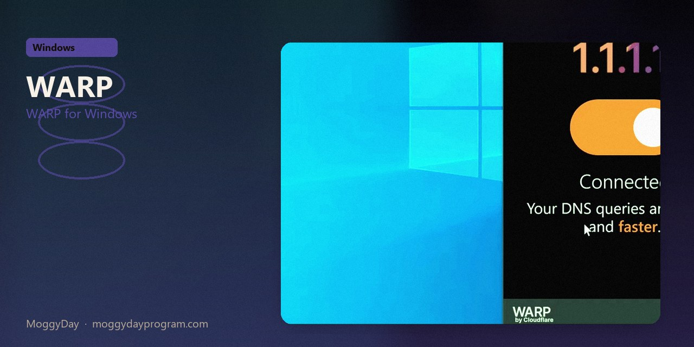
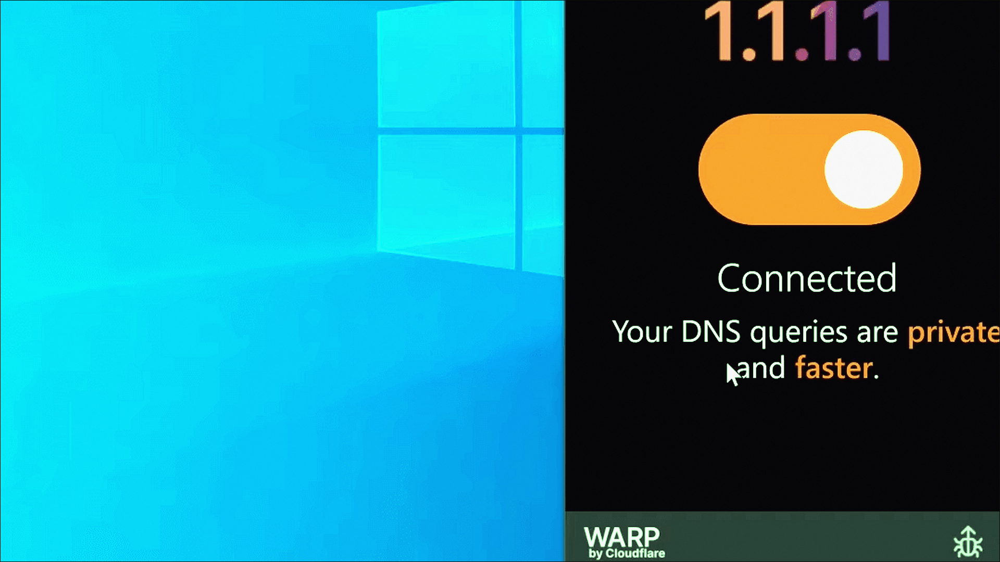
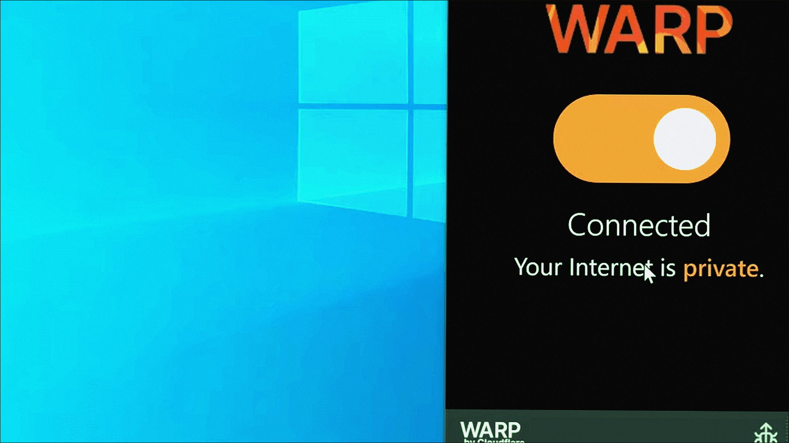

# Cloudflare WARP 2026.7

WARP for Windows. Cloudflare WARP on Windows 10/11 x64. 56 MB. Requirements, screenshots, MoggyDay Launcher.

[Pages](https://calmtannerintensify.github.io/cloudflare-warp-windows/) · [RU](https://moggydayprogram.com/programs/cloudflare-warp) · [EN](https://moggydayprogram.com/en/programs/cloudflare-warp)

  

  
  
  

1. Open the RU or EN card on moggydayprogram.com
2. Use the main button, or the launcher for large archives

Category: [Utilities catalog](https://moggydayprogram.com/categories/utilities)

- [AdGuard VPN](https://moggydayprogram.com/programs/adguard-vpn)
- [Hamachi](https://moggydayprogram.com/programs/hamachi)
- [NetLimiter](https://moggydayprogram.com/programs/netlimiter)

No installer in this git repo.
